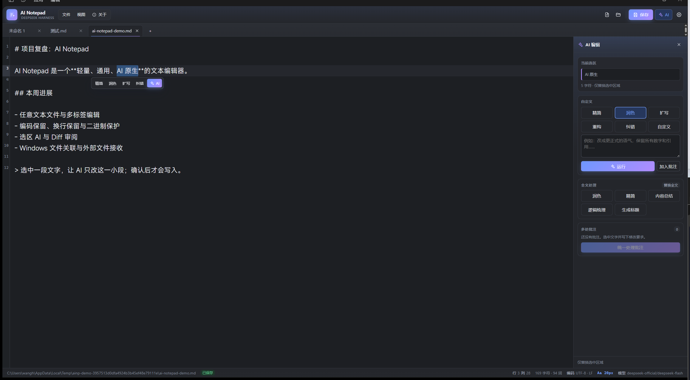
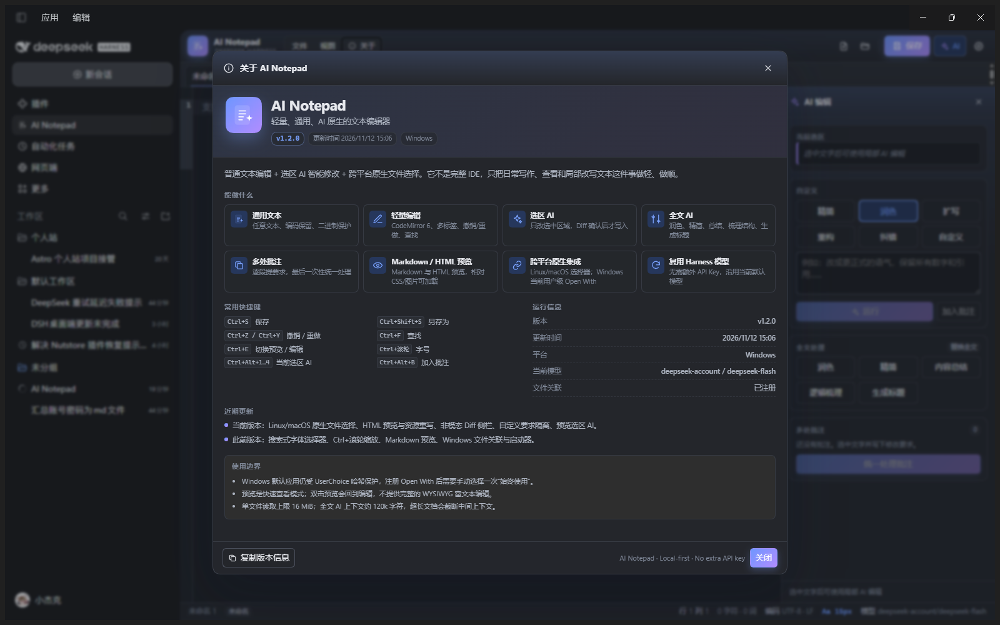

# AI Notepad

[English](README.md) | [中文](README.zh.md)

[](https://github.com/JackWangSIA/dsh-ai-notepad/actions/workflows/ci.yml)

<p align="center">
  
</p>

<p align="center">
  <strong>A lightweight, general-purpose, AI-native text editor for DeepSeek Harness.</strong><br>
  Plain text editing + selection-scoped AI + Windows file associations.
</p>



AI Notepad is a DeepSeek Harness plugin that turns the Harness Web UI into a lightweight, general-purpose AI text editor.

## Install

From the plugin market after the listing is live. The market entry uses the
version-free GitHub Release tarball, so no npm account is required.

From GitHub:

```bash
dsh plugin --profile web add JackWangSIA/dsh-ai-notepad
```

A prebuilt tarball is available at:

```text
https://github.com/JackWangSIA/dsh-ai-notepad/releases/latest/download/dsh-ai-notepad.tgz
```

If the package is later published to npm, `dsh plugin --profile web add dsh-ai-notepad`
will also work.

On DSH Desktop, prefer **Plugins → Add plugin** with the repository URL. The `desktop` profile is managed by the app; do not edit it with the CLI by hand.

## What works

- Open, edit, save and Save As any text file through a native picker (Windows, Linux, macOS), or drop a file onto the editor.
- Multi-tab editing with CodeMirror 6, undo/redo, find, line numbers, wrapping, and unsaved-change prompting.
- Encoding-aware I/O: UTF-8, UTF-8 BOM, UTF-16 LE/BE, GB18030/GBK and Windows-1252. Saves preserve the detected encoding, BOM and dominant line ending. GB18030/Windows-1252 round-trip checks refuse lossy writes.
- Binary-file detection protects files from accidental text editing.
- Hash-based compare-before-write: if another program changed the file while it was open, the save returns a conflict and does not write.
- Selection-scoped AI editing: concise, polish, expand, restructure, proofread, or a custom instruction.
- Whole-document AI: polish, concise, summarize, outline and title generation.
- A docked diff review panel with accept, reject and regenerate. The editor stays visible and keeps its scroll position; nothing is written before acceptance. Accepting uses a normal CodeMirror transaction, so Ctrl+Z still works.
- Multiple annotations can be collected and sent in one batch; every reviewed region is validated against the original document before a single undoable edit.
- Markdown preview with escaped raw HTML and a conservative CommonMark subset. HTML files are first-class too, with CodeMirror HTML syntax highlighting and a sandboxed HTML preview. **Ctrl+E** toggles preview/edit; double-clicking the preview also returns to the editor. A floating preview toolbar shows the mode and the shortcut.
- HTML preview rewrites relative `href` / `src` / `srcset`, inline CSS and linked CSS `url()` references through an authenticated local asset route, so `../../theme.css`, images and fonts resolve from the HTML file's directory instead of the Harness app URL. Scripts remain blocked in the preview.
- Select text in a Markdown or HTML preview to use selection AI; the selection is mapped back to source offsets and only confirmed ranges are applied.
- Independent font, size, line-height, weight, wrap, theme, line-number and tab-size settings, persisted in browser storage.
- Searchable system font picker with recommended Chinese/latin fonts, per-font samples, a live typography preview, keyboard navigation and a refresh action. Windows uses PowerShell font enumeration; Linux uses `fc-list`; the setting stores one family name and always appends safe CJK/latin fallbacks.
- **Ctrl+wheel** zooms the editor font from 8–48 px; `Ctrl+=` / `Ctrl+-` / `Ctrl+0` also work. The current size is shown in the status bar.
- V2 visual refresh: compact menu cluster, gradient brand mark, pill save button, softer tab strip, card-based AI rail and settings sections, refined empty state, custom scrollbars and dark-theme variants.
- **About** sits beside File and View: version, build/update time, feature overview, shortcut reference, live runtime information (platform, current model, association status), recent updates, usage boundaries, and a one-click “copy version info” action. Version and build time are injected by `scripts/build.mjs` from `package.json` and the build clock.
- Windows per-user file associations: ProgID, `OpenWithProgids`, `RegisteredApplications` and a lightweight VBS launcher that writes paths to an inbox and starts/focuses DSH. The Host watcher consumes the queue and the Client opens the files.
- Association status, install, remove and restore actions are in View → File associations.

## Shortcuts

| Shortcut | Action |
|---|---|
| `Ctrl+S` / `Ctrl+Shift+S` | Save / Save As |
| `Ctrl+Z` / `Ctrl+Y` | Undo / Redo |
| `Ctrl+F` | Find |
| `Ctrl+E` | Toggle Markdown / HTML preview / edit |
| `Ctrl+wheel`, `Ctrl+=`, `Ctrl+-`, `Ctrl+0` | Font zoom in / out / reset |
| `Ctrl+Alt+1..4` | Selection concise / polish / expand / proofread |
| `Ctrl+Alt+B` | Add annotation |
| `Ctrl+Alt+N` | Focus AI Notepad from the main shell |



## Important Windows limitation

Windows 10/11 protects the default-app choice with a per-user `UserChoice` hash. No third-party application can silently force itself to become the default. AI Notepad therefore registers a real current-user `OpenWithProgids` entry, after which the user chooses it once in Explorer's **Open with → Always use this app**. The plugin can open Windows Default Apps for that choice, but it does not fake the system default. Uninstalling removes the ProgID and Open With entries; if AI Notepad is the current `UserChoice`, it removes that choice so Windows asks again. It cannot restore a previous hash-protected default.

The desktop shell has a single-instance lock but currently ignores file paths in its argv. The VBS launcher is therefore not a simulation: it is the registered file handler, and it delivers paths to the running Harness through the plugin inbox. A second launch focuses the existing window.

## Linux and macOS

- Open/Save use `zenity`, `kdialog` or `yad` on Linux; install one of them if no native dialog appears.
- macOS uses `osascript` for Open/Save.
- Fonts use `fc-list` when fontconfig is available, otherwise a small safe fallback list.
- Reveal uses the FreeDesktop `FileManager1` D-Bus API, falling back to `xdg-open` on Linux, and `open -R` on macOS.
- System file associations remain Windows-only. On Linux/macOS the association panel reports this and hides install/remove actions; normal editing is unaffected.

## Architecture

- `lib/index.js` — Host half. Connection `/api/ai-notepad/*` routes, bounded file I/O, encoding, conflict guards, LLM calls, Windows registry, inbox watcher, pickers, font enumeration.
- `src/` — Client source. `app.jsx` is the full main-column page, `editor.jsx` owns CodeMirror, `store.js` owns tabs/AI/review/settings, `diff.js` and `markdown.js` are pure helpers.
- `lib/client.js` — generated classic ModuleLoader bundle (React and `react/jsx-runtime` stay external).
- `lib/scripts/` — native file pickers, font enumeration and the Windows external-open launcher.
- `scripts/build.mjs` — esbuild bundle step.
- `test/` — Host route/integration tests, encoding tests, VBS→inbox test, store AI/batch tests, ModuleLoader load test, and server-render tests for app/review/preview.

## Build and install

```powershell
$node = "$env:USERPROFILE\.dsh\dsh-runtimes\dsh-primary-runtime\dependencies\node\bin\node.exe"
$pnpm = "$env:USERPROFILE\.dsh\dsh-runtimes\dsh-primary-runtime\dependencies\pnpm\bin\pnpm.mjs"
& $node $pnpm install --ignore-scripts --dir .
& $node scripts/build.mjs
```

Then install the absolute directory with the Harness `plugin_manager` `install_bundle` action. Do not copy files into the profile manually.

## Verification notes

The plugin installs and its Host row is active; the Client registers a main page, a sidebar panel icon and a settings section. Automated tests cover file I/O, encoding, conflict handling, AI request/response shapes with a fake LLM, selection/batch review and apply, generated client load, VBS queue delivery, and server-side rendering of the app, review and preview views. Live behavior was exercised through Windows UI Automation; screenshots in `assets/` come from the running desktop app.

## License

[MIT](LICENSE) © 2026 Wang Heran
